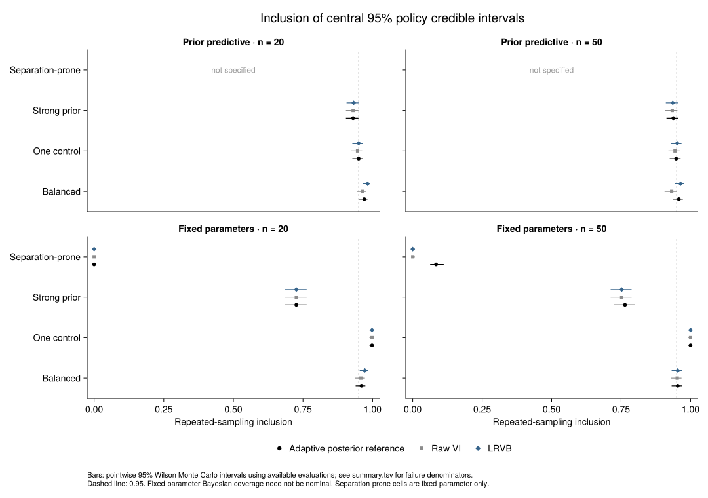

## Bivariate policy calibration, 14 November 2026

The completed study contains 7,000 independently generated datasets and
21,000 method evaluations. Every evaluation was available and passed the
declared numerical gates. LRVB improves some Gaussian policy intervals;
it does not remove prior sensitivity or guarantee frequentist coverage.
No production estimator, prior or acceptance threshold was adjusted to these
results.

### Design and interpretation

The [protocol](../../MULTIVARIATE_POLICY_CALIBRATION.md) specifies 14 cells,
500 datasets per cell, n = 20 or 50, and seed 20261114. The model has an
intercept and binary exposure coefficient with a declared Gaussian prior.
The cohort-conditional target is assignment-to-one versus observed treatment:

ψ = fraction(A = 0) × [logistic(β₀ + β₁) − logistic(β₀)].

Identification remains user-assumed. These are Bayesian credible intervals,
separate from EIF intervals. Coverage is calculated from independently refined
CDFs at the known generating truth. It concerns the ideal selected posterior
law, excluding the additional endpoint randomness of the public finite-draw
Monte Carlo API. The 4,096 Gaussian draws per fit supply descriptive means,
widths and mean MCSEs only. Reference widths and mean errors are not estimated.

### Main results

Values below are percentages; each entry uses all 500 available evaluations.
The complete [table](coverage-table.md), [summaries](summary.tsv), and
[paired differences](paired.tsv) retain all cells and denominators.

| Experiment and scenario | n | Adaptive reference | Raw VI | LRVB |
| --- | ---: | ---: | ---: | ---: |
| Prior predictive, balanced | 20 | 97.0 | 96.4 | 98.2 |
| Prior predictive, balanced | 50 | 95.8 | 93.2 | 96.4 |
| Prior predictive, one control | 20 | 95.0 | 94.6 | 95.0 |
| Prior predictive, one control | 50 | 94.8 | 94.4 | 95.2 |
| Prior predictive, strong prior | 20 | 93.0 | 93.0 | 93.2 |
| Prior predictive, strong prior | 50 | 93.8 | 93.4 | 93.6 |
| Fixed truth, balanced | 20 | 96.0 | 95.8 | 97.2 |
| Fixed truth, balanced | 50 | 95.4 | 95.2 | 95.4 |
| Fixed truth, strong prior | 20 | 72.6 | 72.6 | 72.6 |
| Fixed truth, strong prior | 50 | 76.4 | 75.2 | 75.2 |
| Fixed truth, separation-prone | 20 | 0.0 | 0.0 | 0.0 |
| Fixed truth, separation-prone | 50 | 8.4 | 0.0 | 0.0 |



For balanced prior-predictive n = 50, the paired LRVB minus raw VI difference
is +3.2 percentage points, with paired MCSE 0.79 points. At n = 20 it is
+1.8 points (MCSE 0.60). A higher inclusion rate alone does not establish
better calibration: 98.2% also exceeds the nominal 95%. Other paired gains
are small or absent. These are individual exploratory comparisons, without
multiple-comparison adjustment.

Prior-predictive calibration averages over the declared prior; fixed-truth
coverage conditions on a particular parameter. They answer different questions
([Talts et al., 2018](https://arxiv.org/abs/1804.06788)). The strong-prior
fixed-truth results expose shrinkage sensitivity. In the separation-prone
regime, β = [-3, 6] is poorly supported by the zero-centred prior with covariance
2.25 I. The reference itself has poor fixed-truth coverage; the Gaussian
approximations further under-cover at n = 50. This experiment does not isolate
realised separation as the cause. Raw records distinguish complete, quasi,
single-class and absent separation.

In fact, all 42 reference inclusions at n = 50 occur in the 42 completely
separated datasets; none occur in the 248 nonseparated or 210 quasi-separated
datasets. At n = 20, all three categories have zero reference inclusion.
These descriptive strata reinforce the need to avoid causal attribution to
separation from this experiment.

Fixed-truth one-control coverage is 99.8% at n = 20 and 100% at n = 50 for all
methods. The control count remains one while the target multiplier changes
from 1/20 to 1/50: this is not a general sample-size improvement or a test of
confounding adjustment. Prior-scale cells use independent data and do not
support paired prior-sensitivity comparisons.

Near 95%, the binomial MCSE with 500 replications is about one percentage
point. The plotted bars use pointwise Wilson intervals
([Wilson, 1927](https://doi.org/10.1080/01621459.1927.10502953)). The summary's
plug-in MCSE is zero at 0/500 or 500/500; uncertainty is not zero: the two-sided
95% Wilson upper bound at 0/500 is approximately 0.76%.

### Numerical evidence and performance

An independent audit verified all 21,000 CSV records, 7,000 complete triples,
500 distinct replications per cell/method, target and count identities,
coverage decisions, chained checkpoint digest and current source hashes.
Conditional coverage equals all-attempt inclusion because no result was
unavailable. Numerical error estimates are diagnostics rather than rigorous
probability enclosures.

| Maximum across all datasets | Adaptive reference | Raw VI law | LRVB law |
| --- | ---: | ---: | ---: |
| Refined CDF change | 9.43e-6 | 8.92e-7 | 1.06e-6 |
| Combined tail error estimate | 2.44e-5 | 8.92e-7 | 1.06e-6 |
| Relative normalising mass change | 2.11e-6 | 6.52e-12 | 6.52e-12 |

The full study took 358.46 seconds locally, including a 19.31-second first
call with compilation. Median recorded evaluation time was 6.67 ms for the
reference and approximately 21.2 ms for each Gaussian-law evaluation. Those
timings include different work and are not independent fit benchmarks.
Frequency compression of the n = 50 balanced fixture reduced median reference
evaluation time from 33.17 to 4.28 ms (7.75×, seven warmed serial evaluations),
with a PIT difference of 4.44e-16. This benchmarks the reference optimisation,
not production inference or MCMC. Timings are machine-specific.
The [benchmark record](benchmark.toml) and [reproduction script](benchmark.jl)
retain that comparison.

### Reproduction and boundaries

From the package root, instantiate `test/stress`, then run:

```sh
julia --project=test/stress --threads=auto test/stress/multivariate_policy_calibration.jl --profile validation --replications 500 --seed 20261114 --draws 4096 --out /tmp/policy-calibration
julia --project=docs --threads=auto test/stress/plot_multivariate_policy_calibration.jl /tmp/policy-calibration
```

`raw.tsv.gz` stores every replicate; `metadata.toml` records source hashes,
configuration, backend versions and checkpoint digest. Decompress raw.tsv into
a disposable copy of this directory and run `audit.jl` from the package root
with that directory as its argument. `SHA256SUMS` checks the archived files.

These binary-exposure, correctly specified examples do not validate continuous
or collinear covariates, missingness, misspecification, general confounding or
longitudinal policies. The next useful extension is a separately specified
continuous/correlated-covariate calibration study and paired prior sensitivity
on shared datasets. Retain the experimental uncertainty boundary until that
evidence exists; a covariance correction alone cannot resolve prior conflict.

See [local verification](VERIFICATION.md) for passing checks and the outstanding
full-suite dependency-loading problem.
